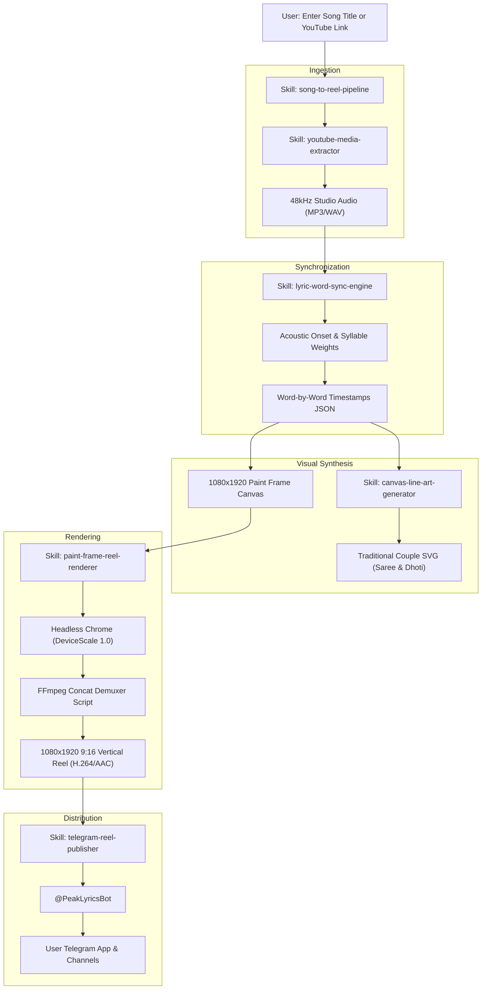

# 🚀 My Agentic Skills

[](https://github.com/Pavan-makwana/My-Agentic-Skills)
[](https://nodejs.org)
[](https://ffmpeg.org)
[](https://core.telegram.org/bots/api)
[](https://opensource.org/licenses/MIT)

> **Curated collection of production-grade Antigravity Agentic Skills** by [Pa1 Makwana](https://github.com/Pavan-makwana). Designed for autonomous AI coding agents to create, synchronize, render, and publish viral vertical Instagram Reels (1080×1920) with millisecond word-by-word typography, cultural SVG line art, and automated Telegram distribution.

---

## 🏛️ System Architecture



---

## 📦 Skills Directory

| Skill | Folder | Scope | Description |
| :--- | :--- | :--- | :--- |
| **`song-to-reel-pipeline`** | [`skills/song-to-reel-pipeline`](./skills/song-to-reel-pipeline) | Orchestrator | Complete end-to-end autonomous pipeline: from song title to published 1080×1920 Reel in Telegram. |
| **`lyric-word-sync-engine`** | [`skills/lyric-word-sync-engine`](./skills/lyric-word-sync-engine) | Timing & AI | RMS energy onset detection and word-by-word progressive typography synchronization. |
| **`canvas-line-art-generator`** | [`skills/canvas-line-art-generator`](./skills/canvas-line-art-generator) | Visual Arts | Minimalist South Indian couple vector line-art (saree, dhoti, malli poo) for beat drops and interludes. |
| **`paint-frame-reel-renderer`** | [`skills/paint-frame-reel-renderer`](./skills/paint-frame-reel-renderer) | Video Engine | Headless Chrome + FFmpeg concat demuxer engine for pixel-perfect 1080×1920 9:16 vertical MP4 rendering. |
| **`youtube-media-extractor`** | [`skills/youtube-media-extractor`](./skills/youtube-media-extractor) | Audio/Media | Single-command `yt-dlp` and FFmpeg utility for downloading high-fidelity 48kHz audio streams. |
| **`telegram-reel-publisher`** | [`skills/telegram-reel-publisher`](./skills/telegram-reel-publisher) | Distribution | Zero-dependency Telegram Bot API integration for auto-uploading and streaming 1080×1920 reels. |

---

## ⚡ Quickstart: Installing into Antigravity

### 1. Global Installation (Recommended)
Copy all skills into your local Antigravity configuration directory:
```bash
# Windows PowerShell
Copy-Item -Recurse -Force skills/* "$env:USERPROFILE\.gemini\config\skills\"

# macOS / Linux
cp -r skills/* ~/.gemini/config/skills/
```

### 2. Workspace Project Installation
Place inside your project's `.agents/` folder:
```bash
mkdir -p .agents/skills
cp -r skills/* .agents/skills/
```

Antigravity will automatically discover all skills via **Progressive Disclosure**.

---

## 🎬 Showcase: Example Outputs Generated by These Skills

- **Day 1: Othaiyadi Pathayila (*Kanaa*)**
  - **Resolution:** 1080×1920 (9:16 vertical)
  - **Hook:** Starts at `20.40s` (trimmed 1s before lyrics drop)
  - **Badge:** `DAY 1 • PEAK TAMIL LYRICS`
  - **Features:** Word-by-word progressive ink highlight, couple line-art during beat drops, auto-delivered to `@PeakLyricsBot`.

- **Day 2: Kanmani Anbodu Kaadhalan (*Acoustic*)**
  - **Resolution:** 1080×1920 (9:16 vertical)
  - **Hook:** Starts at `19.04s` (trimmed 1s before lyrics drop)
  - **Badge:** `DAY 2 • PEAK TAMIL LYRICS`
  - **Features:** Acoustic charanam tempo-matched cadence, organic marker wiggle, auto-delivered to `@PeakLyricsBot`.

---

## 🛠️ Tech Stack & Requirements

- **Runtime:** Node.js v20+ / v22+
- **Media Engine:** FFmpeg v7.0+ (with `libx264` and `aac`)
- **Browser Automation:** `puppeteer-core` with Google Chrome
- **Audio Processing:** Python 3.10+ (`numpy`, `wave`, `speech_recognition`)
- **Downloader:** `yt-dlp`

---

## 📄 License

Distributed under the **MIT License**. See [`LICENSE`](./LICENSE) for details.

---

## 👤 Author

**Pa1 Makwana (Pavan Makwana)**
- GitHub: [@Pavan-makwana](https://github.com/Pavan-makwana)
- LinkedIn: [pavan-makwana](https://www.linkedin.com/in/pavan-makwana-05062oo6/)
- Portfolio: [pavanmakwana.vercel.app](https://pavanmakwana.vercel.app/)
