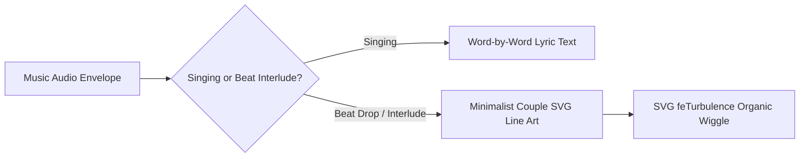

# Canvas Line Art Generator

Eliminates blank canvas dead time during instrumental sections and beat drops by dynamically displaying elegant minimalist vector line art.



## Aesthetic Guidelines
1. **Stroke Matching**: The vector stroke must match the dominant ink palette (`#8c1226` crimson maroon).
2. **Stroke Width**: `3.5px` to `4.5px` with `stroke-linecap="round"` and `stroke-linejoin="round"`.
3. **Organic Hand-Drawn Filter**: Pass through `<filter id="wig">` with `feTurbulence` so the sketch has living, vibrating ink edges.
4. **Cultural Authenticity**:
   - **Man**: Traditional shirt collar, placket, buttons, folded veshti/dhoti with border (*kasavu*).
   - **Woman**: Elegant saree pallu drape across chest, hair bun (*kondai*) with jasmine flowers (*malli poo*), subtle thali curve, and pleated saree skirt.
   - **Accent**: Delicate floating heart symbol connecting the couple.

## SVG Template
```html
<svg viewBox="0 0 400 400" fill="none" stroke="#8c1226" stroke-width="4.2" stroke-linecap="round" stroke-linejoin="round" style="filter:url(#wig);">
  <!-- Man in Shirt & Dhoti -->
  <path d="M140 105 C140 85 155 70 172 70 C190 70 200 85 200 102 C200 118 190 128 175 132" />
  <path d="M145 92 Q160 82 178 82 Q195 82 195 95" />
  <path d="M158 132 L158 148 M182 130 L182 148" />
  <path d="M145 150 Q170 156 195 150 L215 185 L195 195 L190 260 L145 260 L140 195 L120 185 Z" />
  <path d="M155 152 L170 172 L185 152" />
  <path d="M170 172 L170 260" />
  <circle cx="170" cy="190" r="2.5" fill="#8c1226" />
  <circle cx="170" cy="215" r="2.5" fill="#8c1226" />
  <circle cx="170" cy="240" r="2.5" fill="#8c1226" />
  <path d="M145 260 L140 375 L195 375 L190 260" />
  <path d="M167 260 L167 375" />
  <path d="M138 365 L197 365" stroke-width="2" />
  <path d="M139 370 L196 370" stroke-width="3.5" />

  <!-- Woman in Saree -->
  <path d="M228 115 C228 98 240 85 255 85 C270 85 282 98 282 115 C282 128 274 138 260 142" />
  <path d="M232 105 Q255 95 278 105" />
  <path d="M278 110 C292 110 298 122 295 132 C292 140 282 142 275 138" />
  <path d="M280 102 C288 102 292 108 290 114" stroke-dasharray="2 3" stroke-width="3" />
  <path d="M246 142 L246 156 M266 142 L266 156" />
  <path d="M250 156 Q256 166 262 156" />
  <path d="M236 156 Q256 162 276 156 L290 190 L275 198 L270 255 L235 255 L225 198 L215 190 Z" />
  <path d="M228 255 Q245 205 275 158" stroke-width="4.5" />
  <path d="M233 255 Q250 208 280 162" stroke-width="2" />
  <path d="M235 255 Q215 315 220 375 L285 375 Q285 315 270 255" />
  <path d="M280 162 Q298 220 292 310" stroke-width="3.5" />
  <path d="M219 365 L286 365" stroke-width="2" />
  <path d="M220 370 L285 370" stroke-width="4" />

  <!-- Hands & Heart -->
  <path d="M190 200 Q205 230 208 250" />
  <path d="M225 200 Q212 230 210 250" />
  <path d="M205 58 C205 48 215 42 222 48 C229 42 239 48 239 58 C239 70 222 80 222 80 C222 80 205 70 205 58 Z" fill="#8c1226" stroke="none" />
</svg>
```

## Dynamic Canvas Toggling
```javascript
function showInstrumental(captionText) {
  document.querySelector('#ink').style.display = 'none';
  document.querySelector('#coupleArt').style.display = 'flex';
  document.querySelector('#cap').textContent = captionText;
}

function showLyrics() {
  document.querySelector('#coupleArt').style.display = 'none';
  document.querySelector('#ink').style.display = 'grid';
}
```
