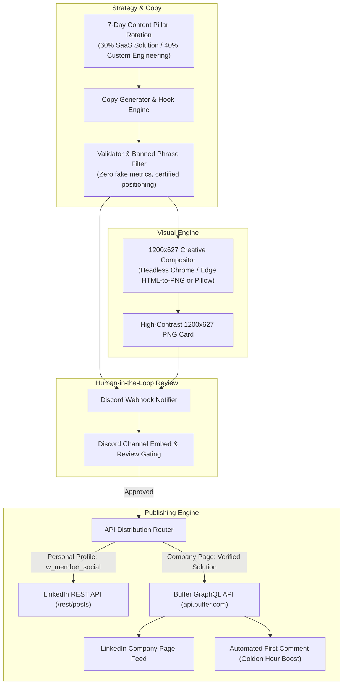

# LinkedIn Marketing Automation Skill

An autonomous, production-grade engineering skill for planning, generating, validating, rendering, and publishing high-converting B2B LinkedIn content to **LinkedIn Company Pages** and **Personal Profiles**.



---

## 🎯 When to Use This Skill

1. **LinkedIn Company Page Publishing:** You need to automate scheduled posts to a LinkedIn Organization/Company Page without getting blocked by LinkedIn Developer Platform partner restrictions.
2. **Founder-Led Marketing & World AI News:** You want automated drafting, staging, and scheduling of technical case studies, SaaS product spotlights, and daily curated worldwide AI news digests (frontier models, autonomous agents, and inference).
3. **Deterministic Visual Generation:** You need 1200×627 landscape social cards generated programmatically from real product screenshots and brand design tokens without AI hallucinations.
4. **Discord Co-Pilot Review:** You want drafts and graphics delivered to a private Discord channel for 1-click team review before anything goes live.

---

## 🔑 The LinkedIn API Reality & How to Solve It

When building LinkedIn automation, you will encounter LinkedIn's strict authorization landscape:

### 1. Direct LinkedIn REST API (`api.linkedin.com/rest/posts`)
- **Scope required for Company Pages:** `w_organization_social` and `r_organization_social`.
- **The Bottleneck:** The **Community Management API** (which grants `w_organization_social`) cannot co-exist on the same developer app with *Share on LinkedIn* (`w_member_social`), and self-serve access is restricted exclusively to approved LinkedIn Marketing Developer Partners.
- **Personal Profiles (`urn:li:person:...`):** Works seamlessly with standard Developer Apps using `w_member_social` via the official `/rest/images` and `/rest/posts` endpoints.

### 2. The Certified Partner Solution: Buffer GraphQL API (`api.buffer.com`)
Instead of fighting enterprise partner approvals, route Company Page publishing through **Buffer** as certified partner middleware:
- Buffer is an official LinkedIn Developer Partner with full organization permissions.
- Connecting your LinkedIn Company Page to Buffer is a 1-click OAuth flow as a Page Super Admin.
- Buffer exposes a high-speed **GraphQL API (`https://api.buffer.com`)** that allows programmatic drafting, scheduling, and direct publishing (`mode: shareNow` or `customScheduled`).
- **Bonus:** Supports automated `firstComment` metadata on LinkedIn posts to boost early algorithmic reach.

---

## 🛠️ Step-by-Step Setup Guide

### Step 1: Connect LinkedIn Page to Buffer
1. Create a free account at [Buffer](https://buffer.com).
2. Click **Connect Channel** → **LinkedIn** → **Company Page**.
3. Select your company page (requires **Super Admin** role on LinkedIn) and authorize.

### Step 2: Generate Buffer API Key
1. Navigate to [Buffer API Settings](https://buffer.com/settings/api).
2. Click **Create API Token** / **Generate API Key**.
3. Copy your token (e.g., `-IHY2Pxjx4awY1xm...`).

### Step 3: Discover Your Channel ID
Query Buffer's GraphQL endpoint to retrieve your organization and channel IDs:

```graphql
query GetChannels($input: ChannelsInput!) {
  channels(input: $input) {
    id
    name
    service
  }
}
```

Python snippet to discover your channel:
```python
import requests

token = "YOUR_BUFFER_API_KEY"
headers = {"Authorization": f"Bearer {token}", "Content-Type": "application/json"}

# 1. Fetch Organization ID
acc_res = requests.post("https://api.buffer.com", headers=headers, json={
    "query": "query { account { organizations { id name } } }"
}).json()
org_id = acc_res["data"]["account"]["organizations"][0]["id"]

# 2. Fetch Channels
ch_res = requests.post("https://api.buffer.com", headers=headers, json={
    "query": "query GetChannels($input: ChannelsInput!) { channels(input: $input) { id name service } }",
    "variables": {"input": {"organizationId": org_id}}
}).json()

print("Channels:", ch_res["data"]["channels"])
```

---

## 📝 Buffer GraphQL Client Implementation

Here is the production-grade Buffer client with draft staging, immediate publishing, scheduling, and automated first comments:

```python
import requests
import json

class BufferClient:
    """Official GraphQL API client for Buffer to publish directly to LinkedIn Company Pages."""

    ENDPOINT = "https://api.buffer.com"

    def __init__(self, api_key: str, channel_id: str):
        self.api_key = api_key
        self.channel_id = channel_id

    def _headers(self) -> dict:
        return {
            "Authorization": f"Bearer {self.api_key}",
            "Content-Type": "application/json"
        }

    def _execute(self, query: str, variables: dict = None) -> dict:
        payload = {"query": query}
        if variables:
            payload["variables"] = variables
        
        resp = requests.post(self.ENDPOINT, headers=self._headers(), json=payload, timeout=30)
        data = resp.json()
        if "errors" in data and data["errors"]:
            raise RuntimeError(f"Buffer GraphQL Error: {json.dumps(data['errors'])}")
        return data.get("data", {})

    def create_draft(self, text: str, first_comment: str = None) -> dict:
        """Saves a post as a Draft in Buffer for human review."""
        return self._create_post(text=text, mode="addToQueue", save_to_draft=True, first_comment=first_comment)

    def schedule_post(self, text: str, due_at_utc: str, first_comment: str = None) -> dict:
        """Schedules a post for a specific ISO-8601 UTC timestamp."""
        return self._create_post(text=text, mode="customScheduled", save_to_draft=False, due_at=due_at_utc, first_comment=first_comment)

    def publish_now(self, text: str, first_comment: str = None) -> dict:
        """Immediately publishes the post live to the LinkedIn Company Page."""
        return self._create_post(text=text, mode="shareNow", save_to_draft=False, first_comment=first_comment)

    def _create_post(self, text: str, mode: str, save_to_draft: bool, due_at: str = None, first_comment: str = None) -> dict:
        mutation = """
        mutation CreatePost($input: CreatePostInput!) {
          createPost(input: $input) {
            ... on PostActionSuccess {
              post {
                id
                text
                status
                dueAt
              }
            }
            ... on MutationError {
              message
            }
          }
        }
        """

        post_input = {
            "channelId": self.channel_id,
            "text": text,
            "schedulingType": "automatic",
            "mode": mode,
            "saveToDraft": save_to_draft,
            "needsApproval": False
        }

        if due_at:
            post_input["dueAt"] = due_at

        if first_comment:
            post_input["metadata"] = {
                "linkedin": {
                    "firstComment": first_comment
                }
            }

        data = self._execute(mutation, {"input": post_input})
        result = data.get("createPost", {})
        if "message" in result:
            raise RuntimeError(f"Buffer Mutation Error: {result['message']}")

        post = result.get("post", {})
        return {
            "success": True,
            "post_id": post.get("id"),
            "status": post.get("status"),
            "due_at": post.get("dueAt")
        }
```

---

## 🎨 Deterministic 1200x627 Graphics Compositor

LinkedIn cards require an exact **1200 × 627 pixels (1.91:1 ratio)** for crisp feed display without cropping.

### Architecture:
1. Define responsive HTML/CSS templates styled with your brand's typography, color tokens, and layout cards.
2. Render locally using **Headless Chrome or Edge** via CLI flags:
   ```bash
   chrome --headless=new --disable-gpu --window-size=1200,627 --force-device-scale-factor=1 --screenshot=output.png temp.html
   ```
3. Verified zero hallucinations: Injects real product screenshots and SVG brand marks rather than generating unstable synthetic pixels.

---

## 🔔 Discord Co-Pilot Review Integration

Keep a human in the loop before scheduled posts go live:

```python
import json
import requests
from pathlib import Path

class DiscordNotifier:
    def __init__(self, webhook_url: str):
        self.webhook_url = webhook_url

    def send_preview(self, title: str, copy: str, image_path: Path | str, scheduled_time_ist: str = "9:00 PM IST"):
        path = Path(image_path)
        payload = {
            "content": f"**🔔 [Preview] Upcoming LinkedIn Post Scheduled for {scheduled_time_ist}**",
            "embeds": [
                {
                    "title": f"📋 {title}",
                    "description": f"```\n{copy[:3500]}\n```",
                    "color": 3719160, # Brand Cyan / Accent
                    "fields": [
                        {"name": "⏰ Scheduled Time", "value": scheduled_time_ist, "inline": True},
                        {"name": "🛡️ Status", "value": "Awaiting Verification", "inline": True}
                    ],
                    "image": {"url": "attachment://linkedin_preview.png"}
                }
            ]
        }

        with open(path, "rb") as f:
            files = {
                "file": ("linkedin_preview.png", f, "image/png"),
                "payload_json": (None, json.dumps(payload))
            }
            requests.post(self.webhook_url, files=files, timeout=20)
```

---

## 🌍 Autonomous Daily World AI News Pipeline

To maintain high authority and explosive organic reach beyond self-promotional content, the skill includes a **Daily Global AI News Engine** (`scripts/ai_news_fetcher.py`):

1. **Autonomous Ingestion:** Connects to live feeds (TechCrunch AI, Hacker News, Arxiv, GitHub AI) to discover breaking frontier developments, model releases, and infrastructure breakthroughs.
2. **De-Noising & Filtering:** Strips gossip and extracts 3–4 high-density stories (Frontier Models, Distributed Inference, Autonomous Computer-Use Agents, Hardware).
3. **Synthesis Engine:** Crafts high-conversion LinkedIn posts with an urgent opening hook, concrete bullet breakdowns, a strategic macro perspective ("The Big Picture"), and an engaging debate question to drive comment velocity.
4. **Automated Buffer Scheduling:** Automatically targets 9:00 PM IST (15:30 UTC) daily without manual intervention.

```python
from scripts.ai_news_fetcher import AINewsFetcher

# Runs on cron or background daemon
fetcher = AINewsFetcher()
result = fetcher.schedule_daily_post(target_hour=21, target_minute=0)
print(f"Scheduled Post ID: {result['buffer_post_id']} for {result['scheduled_time']}")
```

---

## 📊 High-Converting B2B LinkedIn Copy Structure

A proven format that drives organic discovery and founder-led authority:

```markdown
[PUNCHY HOOK: Relatable crisis, contrarian statement, or peak rush-hour scenario]

[THE OPERATIONAL BOTTLENECK: 3 bullet points quantifying lost revenue or wasted team hours]
• Pain point 1
• Pain point 2
• Pain point 3

[THE ENGINEERING BREAKTHROUGH: How your product or architecture solves it fundamentally]
⚡ Feature 1 – Operational benefit
⚡ Feature 2 – Concrete speed or accuracy gain
⚡ Feature 3 – Automation benefit

[CORE BRAND POSITIONING STATEMENT]
"Great food builds a restaurant's reputation. Dependable, high-speed software protects its profit margins."

👉 [DIRECT CTA WITH VERIFIED LINK]:
https://yourdomain.com

[TARGETED HASHTAG MATRIX: 4 broad volume + 4 niche buyer tags]
#FoodTech #RestaurantOperations #HospitalityIndustry #SaaS #CloudKitchen #QSR #BusinessAutomation #ALOXOIT
```

---

## 🚀 Key Takeaways & Best Practices

| Area | Best Practice | Anti-Pattern |
| :--- | :--- | :--- |
| **API Auth** | Use Buffer GraphQL middleware for Company Pages. | Don't spend weeks begging LinkedIn Developer Support for `w_organization_social`. |
| **Visual Assets** | Render deterministic HTML/CSS templates via headless browser. | Don't use raw generative AI image tools that hallucinate UI text. |
| **Hashtags** | Blend 4 broad discovery tags (100k+ followers) with 4 high-intent buyer tags. | Don't dump 30 generic buzzwords like `#viral #trending`. |
| **Safety** | Enforce human-in-the-loop Discord preview gating. | Never let automated loops publish directly without idempotency history checks. |
