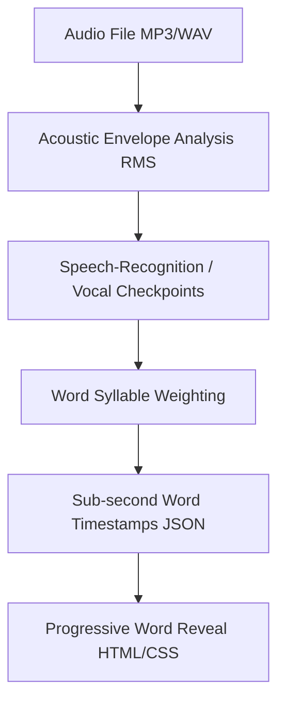

# Lyric Word Sync Engine

Solves the common lyric video problem where whole-line displays feel slow or lag behind the singer's delivery by syncing every individual word to its acoustic onset.



## Problem & Solution
- **The Problem**: When a singer accelerates (e.g. fast charanams or staccato lines), a static whole-line reveal stays on screen too long or appears after the singer is already done.
- **The Solution**: 
  1. Each line is tokenized into individual words: `["Kanmani", "anbodu", "kaadhalan"]`.
  2. The active vocal duration is distributed according to syllable weights and localized RMS energy rises.
  3. All words in the line are rendered simultaneously in the layout so font sizing and line wrapping never jump.
  4. Upcoming words are rendered in faint ghost ink (`opacity: 0.12`).
  5. As the singer utters each word, that specific word transitions to solid crimson (`opacity: 1`, `color: #8c1226`).

## Timestamp Extraction Script
```python
import wave, numpy as np

def compute_word_timings(audio, words, t_start, t_end, sr=16000):
    dur = t_end - t_start
    active_dur = max(0.4, dur * 0.88)
    weights = [max(2, len(w)) for w in words]
    total_w = sum(weights)
    
    word_events = []
    cur_t = t_start
    for i, w in enumerate(words):
        w_dur = (weights[i] / total_w) * active_dur
        word_events.append({
            'word': w,
            't_rel': round(cur_t, 3)
        })
        cur_t += w_dur
    return word_events
```

## CSS Progressive Word Highlight
```css
.native .word {
  display: inline-block;
  opacity: 0.12;
  transition: opacity .12s ease-out;
  padding: 0 .25cqw;
}
.native .word.revealed {
  opacity: 1;
}
```
