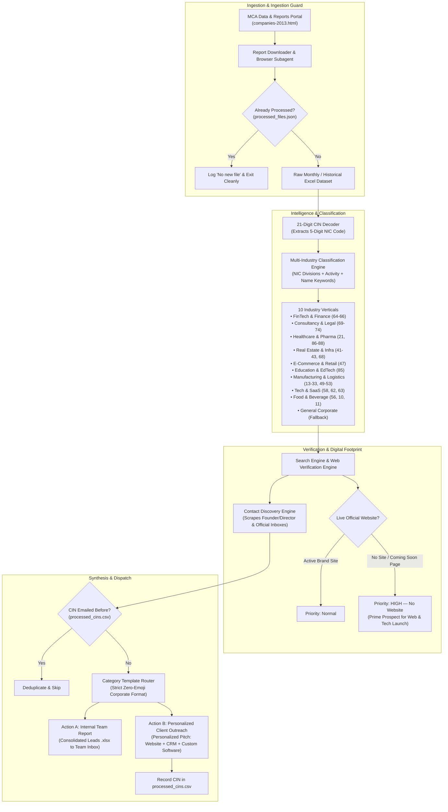

# MCA Lead & Multi-Industry Email Automation Skill

An autonomous, production-grade engineering skill for scraping newly registered Indian companies from the **Ministry of Corporate Affairs (MCA)** portal, classifying them by their **nature of business** via embedded **National Industrial Classification (NIC)** codes, verifying their live digital presence (website status, social links, contact emails), and dispatching tailored, **zero-emoji** B2B outreach campaigns with zero manual intervention.



---

## When to Use This Skill

1. **Autonomous B2B Lead Generation:** You want to capture newly incorporated Indian companies every month as soon as MCA uploads its official registry files.
2. **Multi-Industry Service Pitching:** You run a digital agency, software consultancy, or corporate service provider (e.g., **ALOXO IT LLP**) that offers websites, CRMs, and custom software, and you need to tailor pitches differently for FinTech, Healthcare, Real Estate, E-Commerce, etc.
3. **Website Presence Detection:** You need an automated system that distinguishes between companies with established websites versus those that have **no website** or are stuck on **"Coming Soon"** countdown placeholders.
4. **Zero-Emoji Corporate Deliverability:** You need professional, high-deliverability email templates with zero emojis, full spam compliance, and verifiable sender branding.
5. **Scheduled Cron Sidecars:** You want to run the pipeline automatically on a recurring schedule (e.g., 5th, 10th, and 15th of every month) via Antigravity Automations.

---

## 21-Digit CIN Decoding & NIC Classification Engine

In India, every registered company is assigned a 21-digit **Corporate Identification Number (CIN)** structured deterministically:

$$\text{CIN Format: } \underbrace{\text{U / L}}_{\text{Listing Status}} \; \underbrace{\mathbf{XXXXX}}_{\mathbf{5\text{-Digit NIC Code}}} \; \underbrace{\text{XX}}_{\text{State RoC}} \; \underbrace{\text{YYYY}}_{\text{Year}} \; \underbrace{\text{PTC/PLC/LLP}}_{\text{Type}} \; \underbrace{\text{ZZZZZZ}}_{\text{Registration Number}}$$

*Example:* `U66190GJ2026PTC175945`
- `U`: Unlisted company
- **`66190`**: 5-Digit NIC Code (`Activities auxiliary to financial service activities n.e.c.`)
- `GJ`: Gujarat (RoC Ahmedabad)
- `2026`: Year of Incorporation
- `PTC`: Private Limited Company
- `175945`: Sequential registration number

### Supported Industry Verticals

| # | Industry Category | NIC Codes / Divisions | Starter Pack Pitch | Included Offerings |
|---|---|---|---|---|
| **1** | **Finance, Wealth & FinTech** | Division 64, 65, 66 | Finance & Wealth Digital Starter Pack | High-Trust Financial Brand Website, Finance Management CRM & Lead Pipeline, Invoicing & Billing Dashboard, Custom Software Solutions |
| **2** | **Consultancy & Legal Practice** | Division 69, 70, 71, 73, 74 | Professional Practice & Firm Digital Pack | High-Converting Corporate Web Presence, Consultancy CRM & Retainer Invoicing, Client Portal & Calendar Sync, Custom Software Solutions |
| **3** | **Healthcare, Clinics & Pharma** | Division 21, 86, 87, 88 | Healthcare Digital Suite & Clinic ERP | Official Healthcare & Clinic Website, Clinic Management CRM & Patient Scheduling, Pharmacy Billing & Inventory, Custom Software Solutions |
| **4** | **Real Estate, Construction & Infra** | Division 41–43, 68 | Real Estate Builder & Project Launch Pack | Modern Project Showcase Website, Real Estate Lead CRM with Auto-Distribution, Customer Booking & Payment Milestone Manager, Custom Software Solutions |
| **5** | **E-Commerce, D2C & Retail** | Division 47 | All-in-One E-Commerce Launch Suite | High-Conversion Custom E-Commerce Website, Retail CRM, Inventory Sync & Order Management, Shipping Automation & Payment Gateways, Custom Software Solutions |
| **6** | **Education, EdTech & Academies** | Division 85 | EdTech & Institutional Management Suite | Official Institutional Brand Website, Education CRM & Online Admission Portal, Online Fee Collection & Digital Receipts, Custom Software Solutions |
| **7** | **Industrial, Manufacturing & Logistics** | Division 13–33, 49–53 | Industrial Digital & Supply Chain Pack | Modern Industrial & Corporate Website, Manufacturing & Operations Management CRM, Warehouse & Inventory Tracking Portal, Custom Software Solutions |
| **8** | **IT, Software & SaaS Startups** | Division 58, 62, 63 | Tech Acceleration & Custom Engineering Suite | Modern Tech Brand Website & Product Landing Pages, Tech Talent Staffing & Dedicated Engineering, Cloud Architecture & CI/CD DevOps Setup, Custom Software Solutions |
| **9** | **Food, Beverage & Hospitality** | Division 56, 10, 11 | All-in-One Food Business Starter Pack | Custom Online Food Ordering Website, FSSAI Food License & Compliance, Smart POS Billing System (KOT & GST), Custom Software Solutions |
| **10**| **General Corporate (Fallback)** | All other registrations | Enterprise Digital Launch Package | High-Impact Corporate Website & Brand Identity, Business Management CRM & Client Funnel, Invoicing, Billing & Operations Automation, Custom Software Solutions |

---

## Web Enrichment & Website Verification Logic

The web enrichment engine (`scripts/enrich_company_details.py`) solves the common problem of hallucinated websites by applying multi-layer verification:

1. **Domain Relevance Matching:** Compares company name tokens against candidate domain URLs, titles, and snippets.
2. **Directory & Government Blacklisting:** Strips generic registries (`zaubacorp.com`, `tofler.in`, `instafinancials.com`, `mca.gov.in`, `indiamart.com`, `justdial.com`, `wikipedia.org`).
3. **Document Filtering:** Rejects PDF, DOC, and spreadsheet download links.
4. **"Coming Soon" Page Detection:** Inspects homepage DOM for placeholder text (`Coming Soon`, `Under Construction`, countdown timers) and flags them as **`HIGH — No Website`** priority targets.
5. **Contact Discovery:** Extracts public director names, corporate emails (`contact@`, `shubham@`, `info@`), WhatsApp links, and Google Maps search queries.

---

## Strict Zero-Emoji Corporate Standard

All HTML email templates in `templates/categories/` strictly adhere to a **zero-emoji rule**:
- **Why:** In enterprise B2B sales (Finance, Healthcare, Legal, Corporate Boards), emoji icons in subject lines or body text trigger spam filters, look unprofessional, and reduce response rates from founders and C-level executives.
- **Enforcement:** Automated linting via regex pattern matching strips all Unicode emoji blocks prior to SMTP dispatch.
- **Header Formatting:** Highlighting uses clean, modern CSS badges, subtle accent left-borders (`4px solid #1d4ed8`), and readable typography.

---

## Email Dispatch Architecture

### Action A — Internal Team Report
Every run compiles an enriched Excel spreadsheet:
```
mca_leads/YYYY-MM/all_companies_categorized_YYYY-MM.xlsx
```
The file is emailed to the internal sales mailbox (`TEAM_INBOX_EMAIL`) with high-level metrics:
- Total companies discovered
- Industry breakdown counts
- High-priority companies with no website
- State-wise RoC distribution

### Action B — Personalized Client Cold Outreach
For every verified company that has not been emailed before:
- Renders the designated category HTML template.
- Prepopulates company name, director name, and sender details.
- Inserts the detected company contact header.
- Enforces a **15-to-30-second randomized delay** between dispatches to protect sender reputation.
- Appends the company CIN and timestamp to `mca_leads/processed_cins.csv`.

---

## Project Structure

```
mca-lead-email-automation/
├── SKILL.md                                 # Complete engineering guide (this file)
├── scripts/
│   ├── categorize_companies.py              # 21-digit CIN & NIC classification engine
│   ├── enrich_company_details.py            # Web search, website check & contact discovery
│   ├── process_historical_dataset.py        # 12-month historical data ingestion & workbook splitter
│   └── send_category_emails.py              # Multi-industry email dispatcher & dry-run runner
└── templates/
    └── categories/
        ├── fintech_finance.html             # Finance & Wealth template
        ├── consultancy_services.html        # Professional Practice template
        ├── healthcare_pharma.html           # Healthcare & Clinic ERP template
        ├── real_estate_construction.html    # Real Estate & Builder template
        ├── ecommerce_retail.html            # E-Commerce & D2C template
        ├── education_edtech.html            # Education & EdTech template
        ├── manufacturing_logistics.html     # Industrial & Logistics template
        ├── it_saas_tech.html                # Tech & SaaS template
        ├── food_beverage.html               # Food & Hospitality template
        └── general_corporate.html           # Enterprise Launch fallback template
```

---

## Configuration (`.env`)

```ini
# SMTP / Email Settings
SMTP_HOST=smtp.gmail.com
SMTP_PORT=587
SENDER_EMAIL=your_email@gmail.com
SENDER_APP_PASSWORD=your_16_digit_google_app_password

# Internal Team Recipient
TEAM_INBOX_EMAIL=your_team@yourdomain.com

# Outreach Mode (false = log drafts only; true = live sending)
AUTO_SEND_OUTREACH=false

# Sender Branding (ALOXO IT LLP)
SENDER_NAME=ALOXO IT Team
SENDER_COMPANY=ALOXO IT LLP
SENDER_PHONE=+91 93137 33349
SENDER_WEBSITE=https://quantatechlabs.com
```

> **Note on Gmail:** Always use a 16-letter **Google App Password** generated at [myaccount.google.com/apppasswords](https://myaccount.google.com/apppasswords) with 2-Step Verification enabled.

---

## Step-by-Step Usage Guide

### 1. Dry-Run Preview
Preview the subject lines, targets, and category template assignments without sending emails:
```powershell
python scripts/send_category_emails.py --dry-run
```

### 2. Test Send All Categories to an Internal Email
Deliver a live preview of all 10 category templates directly to your inbox:
```powershell
python scripts/send_category_emails.py --test-email your_email@gmail.com
```

### 3. Ingest Historical 12-Month Datasets
Drop any monthly MCA files into `mca_leads/historical_12_months/raw/` and run:
```powershell
python scripts/process_historical_dataset.py
```
This produces categorized workbooks for each vertical in `mca_leads/historical_12_months/processed/`.

### 4. Configure Scheduled Automation Cron
Set up the sidecar automation to check the MCA portal on the **5th, 10th, and 15th** of every month at **10:00 AM IST**:
```
CRON_TZ=Asia/Kolkata 0 10 5,10,15 * *
```
If no new monthly report is detected, the run logs the check and exits cleanly without sending duplicate emails.
