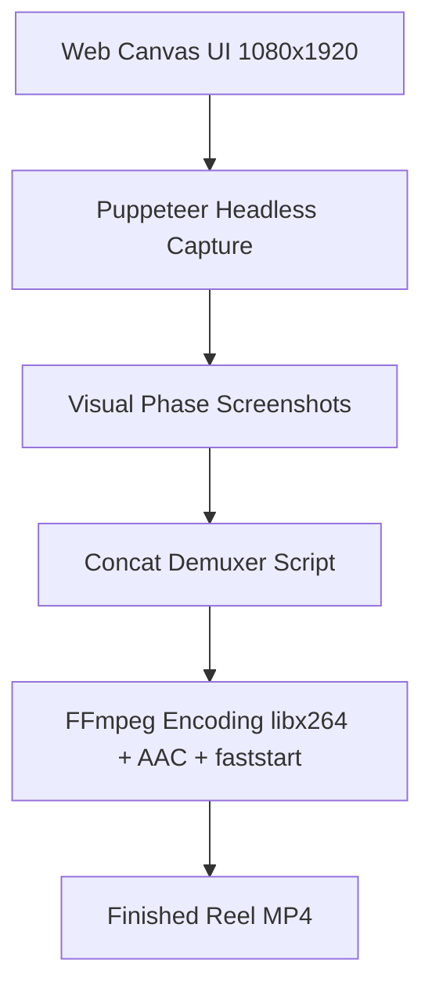

# Paint Frame Reel Renderer

Renders pixel-perfect 1080x1920 vertical video frames in headless Chrome, builds a micro-timed FFmpeg concat demuxer script, and encodes the final H.264 MP4 with 320kbps AAC audio.



## Why Puppeteer + Concat Demuxer?
- **Zero Dropped Frames**: Eliminates screen recording dropped frames and stutter.
- **Microsecond Precision**: Every word or frame state is assigned an exact float duration in seconds.
- **Turbulence Ink Wiggle**: Uses SVG `feTurbulence` and `feDisplacementMap` with rotating seeds to give hand-drawn marker life to static text.
- **Speed**: Encoding runs at 3x–6x realtime speed compared to 1x screen recording.

## Core Render Script Structure
```javascript
const puppeteer = require('puppeteer-core');
const { spawnSync } = require('child_process');

// 1. Launch Puppeteer at 1080x1920
const browser = await puppeteer.launch({
  executablePath: CHROME_PATH,
  args: ['--no-sandbox', '--disable-gpu']
});
const page = await browser.newPage();
await page.setViewport({ width: 1080, height: 1920, deviceScaleFactor: 1 });
await page.goto('file:///' + HTML_PATH);

// 2. Capture Word / Line States
const concatLines = [];
for (const line of linesData) {
  // Capture screenshot...
  concatLines.push(`file '${framePath}'`);
  concatLines.push(`duration ${duration.toFixed(3)}`);
}

// 3. Concat Demuxer Requirement (repeat last frame)
concatLines.push(concatLines[concatLines.length - 2]);
fs.writeFileSync('concat.txt', concatLines.join('\n'));

// 4. Encode with FFmpeg
spawnSync(FFMPEG_PATH, [
  '-f', 'concat', '-safe', '0', '-i', 'concat.txt',
  '-ss', String(audioStartOffset),
  '-i', songAudioPath,
  '-c:v', 'libx264', '-pix_fmt', 'yuv420p', '-r', '30',
  '-c:a', 'aac', '-b:a', '320k',
  '-shortest', '-movflags', '+faststart',
  '-y', outputMp4Path
]);
```

## Key Optimization Rules
1. **Snappy Reveals**: Reveal animations must not exceed 0.24s during rapid singing.
2. **Device Scale Factor**: Set `deviceScaleFactor: 1` to ensure exact 1080x1920 resolution without memory bloat.
3. **+faststart**: Always include `-movflags +faststart` so reels buffer instantly on Instagram and Telegram.
