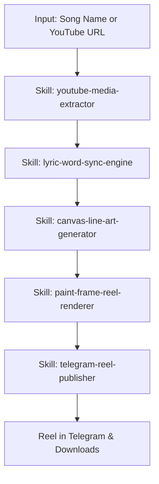

# Song to Reel Master Pipeline

The unified agentic pipeline that orchestrates all sub-skills into an autonomous workflow: from raw song input to a published, studio-grade Instagram Reel.



## Step-by-Step Autonomous Workflow

1. **Extraction**:
   - Downloads 48kHz audio using `youtube-media-extractor`.
2. **Lyric & Timing Alignment**:
   - Detects the first vocal phrase.
   - Calculates the **Instant Hook Offset**: video starts exactly 1.0 second before singing begins.
   - Tokenizes lines into word events with acoustic onset timestamps via `lyric-word-sync-engine`.
3. **Artwork & Badge Ingestion**:
   - Sets dynamic series header badge (e.g. `DAY {N} • PEAK TAMIL LYRICS`).
   - Injects traditional couple SVG line art (`canvas-line-art-generator`) during instrumental pauses and beat drops.
4. **Studio-Quality Render**:
   - Renders 1080x1920 vertical frames in headless Chrome with SVG turbulence displacement.
   - Encodes via FFmpeg with H.264 High Profile + 320kbps AAC and `+faststart` via `paint-frame-reel-renderer`.
5. **Direct Publishing**:
   - Automatically streams the rendered MP4 file to Telegram via `telegram-reel-publisher`.

## Invocation Prompt
```text
Create a Peak Lyrics Reel for: "Kanmani Anbodu Kaadhalan by Sachin Siby"
- Cut intro to 1s before lyrics
- Align word-by-word
- Set Day badge to Day 2
- Deliver directly to my Telegram Bot
```
