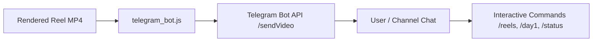

# Telegram Reel Publisher

Automates uploading and streaming studio-grade vertical MP4 videos (up to 50MB) directly to Telegram using standard Telegram Bot API endpoints with zero external npm dependencies.



## When to Use
- You have rendered an MP4 video (especially 1080x1920 9:16 vertical reels) and want to immediately deliver it to Telegram.
- You want an interactive Telegram bot where users can request reels on-demand.
- You want automated pipeline delivery after video rendering finishes.

## Prerequisites
- Node.js 18+ (uses native `fetch`, `FormData`, and `Blob`).
- A Telegram Bot Token from `@BotFather`.
- A target `chat_id` (obtained automatically when a user clicks `/start`).

## Configuration: `telegram_config.json`
```json
{
  "bot_token": "YOUR_BOT_TOKEN_HERE",
  "chat_id": "YOUR_CHAT_ID_HERE",
  "bot_name": "Peak Lyrics",
  "bot_username": "PeakLyricsBot",
  "auto_upload": true
}
```

## Setup & Automated Linking
Run the setup script with your bot token:
```bash
node setup_telegram.js <YOUR_BOT_TOKEN>
```
1. Verifies the token with `getMe`.
2. Prints your bot link (`https://t.me/<bot_username>`).
3. Waits for the user to press `/start` in Telegram.
4. Captures and saves the `chat_id` automatically to `telegram_config.json`.
5. Immediately delivers pending reels.

## Direct API Upload Workflow
```javascript
const fs = require('fs');
const path = require('path');

async function sendReelVideo(videoPath, { day, songTitle }, chatId, botToken) {
  const blob = await fs.openAsBlob(videoPath);
  const form = new FormData();
  form.append('chat_id', chatId);
  form.append('video', blob, path.basename(videoPath));
  form.append('caption', `🎬 <b>Day ${day}</b>: <i>${songTitle}</i>\n✨ 1080x1920 Studio Quality\n⏱ Word-by-word synced`);
  form.append('parse_mode', 'HTML');
  form.append('supports_streaming', 'true');
  form.append('width', '1080');
  form.append('height', '1920');

  const res = await fetch(`https://api.telegram.org/bot${botToken}/sendVideo`, {
    method: 'POST',
    body: form
  });
  return await res.json();
}
```

## Running the Interactive Bot Listener
```bash
node telegram_bot.js listen
```
Responds to:
- `/start` or `/help` - Overview and menu
- `/day1` - Delivers Day 1 Reel
- `/day2` - Delivers Day 2 Reel
- `/reels` - Delivers full series collection
- `/status` - Bot health and chat link status
